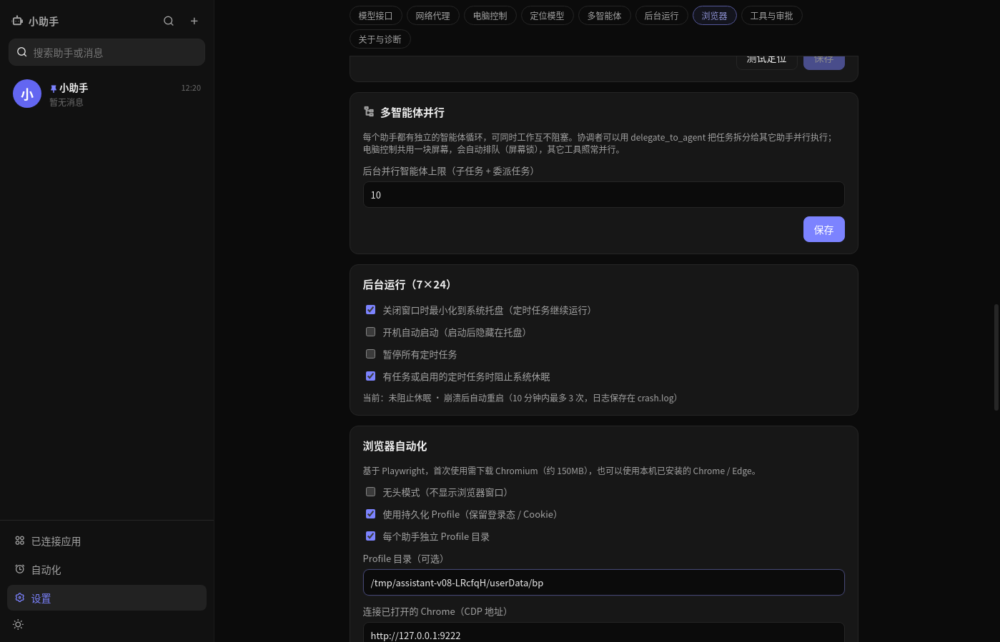
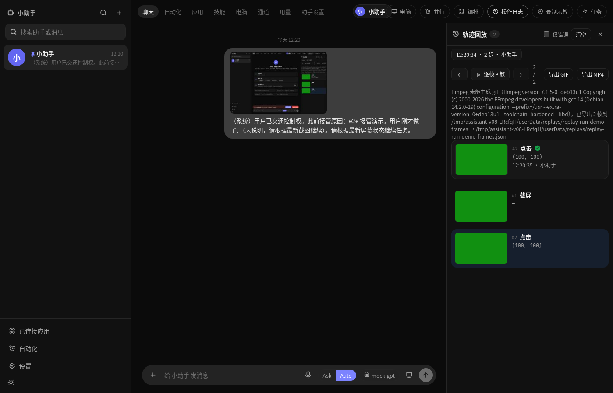
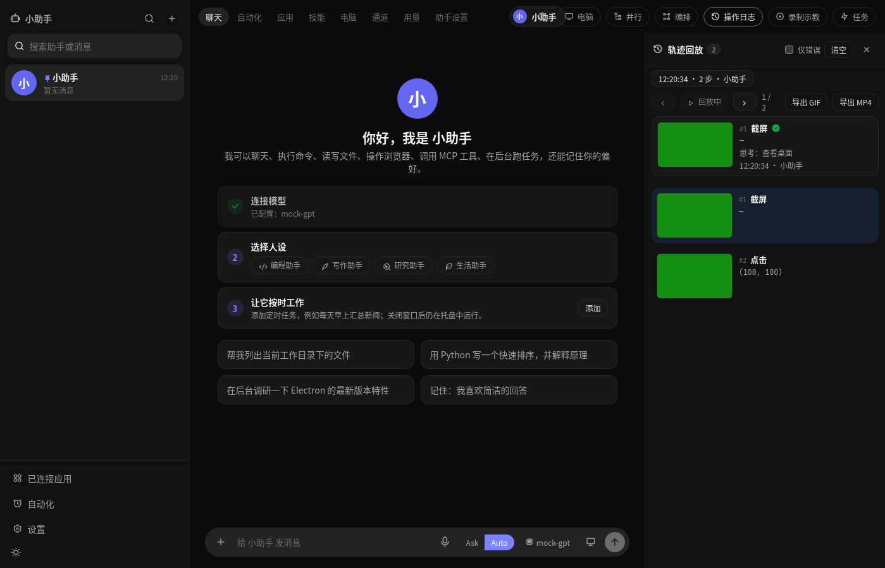
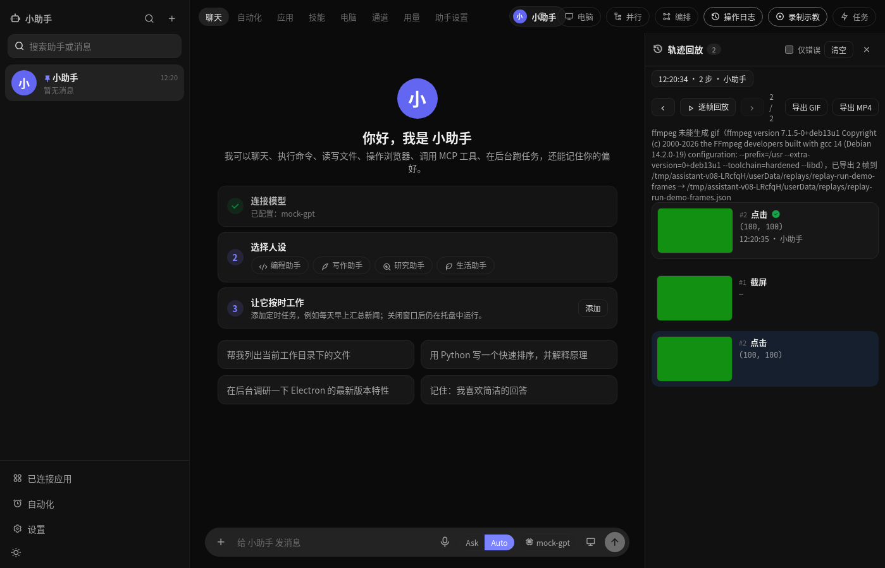

# 小助手 Desktop

**0.8.0** · 能 7×24 操控整台电脑的多智能体桌面 AI 助理。支持任意 OpenAI 兼容接口，界面为简体中文，可切换浅色 / 深色。

## 界面截图



*浏览器设置 / Browser settings*



*对话与轨迹回放 / Chat and trajectory replay*



*回放时间线 / Replay timeline*



*示教开始 / Teach-from-demo start*

## 功能特性

- 持久化 Chromium Profile（保留登录态 / Cookie），可按助手分目录；也支持 CDP 连接已有浏览器。
- 接管与交还、向用户提问（ask_user）、轨迹回放与示教技能。
- 规划、反思与经验记忆；可自建评测集。
- 远程电脑（WebSocket 伴侣）、Telegram / Slack 等消息通道，外发默认需草稿审批。
- 任务编排：大目标拆 DAG、优先级、失败退避、暂停 / 取消。
- 系统 / 自定义代理，模型能力自动检测；纯文本模型可用 OCR 坐标模式操控电脑。

## 技术栈

- Electron + Vite + React + TypeScript
- Playwright / Vitest（测试）

## 从源码运行

源码在仓库根目录。本仓库不包含安装包。

```bash
npm install
npm run dev          # 开发
npm test             # Vitest
npm run build
npm run dist:win     # 如需自行打包 Windows 安装包
```
首次使用需在向导中配置并测试一个 OpenAI 兼容模型。API Key 只保存在本机用户数据目录。更细的功能说明见源码树中的 README。

## 文档


## 贡献

欢迎通过 Issue 和 Pull Request 参与，详见 [CONTRIBUTING.md](CONTRIBUTING.md)。安全问题请按 [SECURITY.md](SECURITY.md) 私下报告。参与时请遵守 [CODE_OF_CONDUCT.md](CODE_OF_CONDUCT.md)。

## 许可证

`package.json` 声明为 MIT。仓库根目录未附带 LICENSE 文件。

---

## English

# Assistant Desktop

**0.8.0** · A multi-agent desktop AI assistant that can operate the computer around the clock. Works with any OpenAI-compatible API. UI is Simplified Chinese, with light/dark themes.

## Screenshots


*浏览器设置 / Browser settings*


*对话与轨迹回放 / Chat and trajectory replay*


*回放时间线 / Replay timeline*


*示教开始 / Teach-from-demo start*

## Features

- Persistent Chromium profiles (cookies / login) per assistant; CDP attach to an existing browser is also supported.
- Takeover and hand-back, `ask_user`, trajectory replay, and teach-from-demo skills.
- Planning, reflection, and experiential memory; you can build your own eval set.
- Remote computers via a WebSocket companion; Telegram / Slack channels with draft approval by default.
- Task orchestration: DAG split, priorities, backoff, pause / cancel.
- System or custom proxies, automatic model-capability detection, and an OCR coordinate mode for text-only models.

## Tech stack

- Electron + Vite + React + TypeScript
- Playwright / Vitest（测试）

## Getting started

Source is at the repository root. This repository does not include installers.

```bash
npm install
npm run dev          # development
npm test             # Vitest
npm run build
npm run dist:win     # optional Windows package
```
On first launch, complete the wizard by connecting and testing an OpenAI-compatible model. API keys stay in the local user data directory. See the in-tree README for a full feature list.

## Documentation


## Contributing

Issues and pull requests are welcome. See [CONTRIBUTING.md](CONTRIBUTING.md). Please report vulnerabilities privately via [SECURITY.md](SECURITY.md). This project follows [CODE_OF_CONDUCT.md](CODE_OF_CONDUCT.md).

## License

`package.json` declares MIT. There is no LICENSE file at the repository root.
